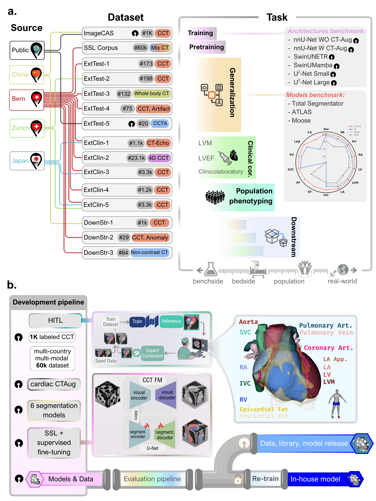

# CCT-FM

**A Unified Framework for Comprehensive Cardiac CT Segmentation and Phenotyping: Human-in-the-Loop Data Annotation, Vision Foundation Model Development, Multicenter Evaluation and Clinical Validation**

[](https://arxiv.org/abs/2607.11287)

## Abstract

> Comprehensive quantification of cardiac structures from computed tomography (CT) remains limited not by data availability but by the scalability of measurements, which makes routine use impractical. Here we present a unified framework for comprehensive cardiac CT segmentation and phenotyping that combines a human-in-the-loop annotation pipeline, a cardiac CT augmentation technique, and a self-supervised foundation model pre-trained on 60,000 unlabeled cardiac CT scans. Using this approach, we assembled the largest and most comprehensive expert-annotated cardiac CT segmentation dataset to date, comprising 1598 cases and 14 distinct cardiac structures (1000 for training, 598 for the external test set). Across five external datasets, the framework segmented all structures more accurately and comprehensively than existing open-source tools. Self-supervised pre-training improved labeling efficiency, with the most significant gains observed during external evaluation in the low-data regime. Benchmarking across convolutional, transformer, and state-space architectures showed comparable performance, indicating that data quality and pre-training, rather than architecture, drove accuracy. The framework was scaled to population-level phenotyping, with segmented anatomy that carries functionally relevant information about ventricular function and disease severity beyond demographic variables. By openly releasing the largest dataset with human labels, code, model weights, a CT augmentation library, and software, this work provides a reproducible foundation for opportunistic cardiac phenotyping from routinely acquired CT scans.

## Overview




## Model Training and Benchmarks
Code for all training runs is in [`model_training_and_benchmarks/`](./model_training_and_benchmarks): self-supervised pre-training on the 60k unlabelled corpus, supervised training of the segmentation models, the architecture and model benchmarks against the five external test sets, and the downstream / label-efficiency grids — all driven through [nnUZoo](https://github.com/AI-in-Cardiovascular-Medicine/nnUZoo). The folder's README lists the trainer name per model, the two required environments, and the exact preprocessing, pre-training, training and testing commands.

## Figures and Statistics
Code for every figure and statistical test computed on the benchmark results is in [`figures-and-statistics/`](./figures-and-statistics): the radar/heatmap comparisons against the open-source tools, the label-efficiency curves with bootstrap confidence intervals, the CT-Aug ablation, the downstream-task bar and box plots, the multi-panel figure assembly, and the Wilcoxon paired tests between models. It reads only the metric JSONs written by the evaluation step, so it needs neither torch nor nnUZoo; the folder's README maps each script to the figure it produces.

## Clinical Evaluation
Code for the clinical and population-scale evaluation is in [`clinical-analysis/`](./clinical-analysis). It tests whether the CT-derived substructure volumes carry information about clinical and laboratory parameters beyond demographics; the folder's README documents the expected data schema. Patient-level data are not released due to data-sharing agreements, but reasonable requests can be directed to the corresponding author.

## CO2 Emission Computation
Code for the carbon-footprint estimates is in [`co2-emission/`](./co2-emission). Emissions for pre-training, training and per-patient inference are computed with the Green Algorithms framework (Lannelongue et al., *Advanced Science*, 2021), with all hardware and grid inputs provided.

# License
ⓒ AI-CVM Lab. This repository is released under the [CC-BY-NC-ND 4.0](./LICENSE.md) license and may only be used for non-commercial, academic research purposes with proper attribution. Any commercial use, sale, or other monetization of this repository is prohibited and requires prior approval. By downloading any pretrained encoder, you agree to follow the model's respective license.


# Citation
Please kindly cite the following paper if you use this repository.

```
@article{kazaj2026unified,
  title  = {A Unified Framework for Comprehensive Cardiac CT Segmentation and Phenotyping:
Human-in-the-Loop Data Annotation, Vision Foundation Model Development, Multicenter Evaluation and Clinical Validation},
  author = {Mohammadi Kazaj, Pooya and Weber, Leo Fridolin and Xie, Wen and Safavi-Naini, Seyed Amir Ahmad and Stark,
Anselm and Baj, Giovanni and Mokhtari, Ali and Yoshida, Toshiya and Ryffel, Christoph and Okuno, Taishi and Akashi,
Yoshihiro and Buechel, Ronny R. and Pilgrim, Thomas and Valenzuela, Waldo and Siontis, George C. M. and Xu, Xiaowei
and Hundertmark, Moritz and Windecker, Stephan and Grani, Christoph and Shiri, Isaac},
  journal = {arXiv preprint arXiv:2607.11287},
  year   = {2026},
  doi    = {10.48550/arXiv.2607.11287},
  url    = {https://arxiv.org/abs/2607.11287}
}

@article{kazaj2025claims,
  author    = {Pooya Mohammadi Kazaj and Giovanni Baj and Yazdan Salimi and Anselm W. Stark and Waldo Valenzuela
                 and George C. M. Siontis and Habib Zaidi and Mauricio Reyes and Christoph Graeni and Isaac Shiri},
  title     = {From Claims to Evidence: A Unified Framework and Critical Analysis of CNN vs. Transformer vs. Mamba in Medical Image Segmentation},
  journal   = {arXiv preprint},
  volume    = {2503.01306},
  year      = {2025},
  archivePrefix = {arXiv},
  primaryClass = {eess.IV},
  doi       = {10.48550/arXiv.2503.01306},
  url       = {https://arxiv.org/abs/2503.01306}
}

```
Mohammadi Kazaj, P., Weber, L. F., Xie, W., Safavi-Naini, S. A. A., Stark, A., Baj, G., Mokhtari, A., Yoshida, T., Ryffel, C., Okuno, T., Akashi, Y., Buechel, R. R., Pilgrim, T., Valenzuela, W., Siontis, G. C. M., Xu, X., Hundertmark, M., Windecker, S., Grani, C., Shiri, I. (2026). A unified framework for comprehensive cardiac CT segmentation and phenotyping: human-in-the-loop data annotation, vision foundation model development, multicenter evaluation and clinical validation. arXiv preprint arXiv:2607.11287.
```